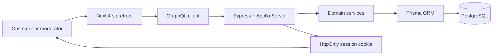
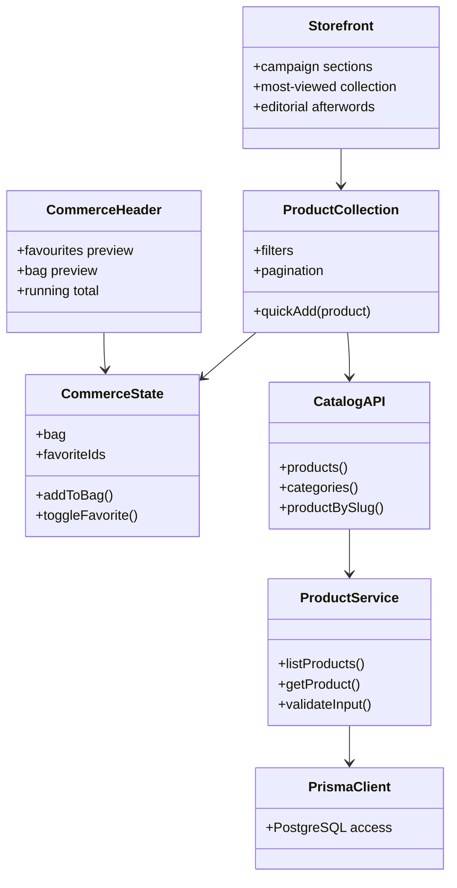
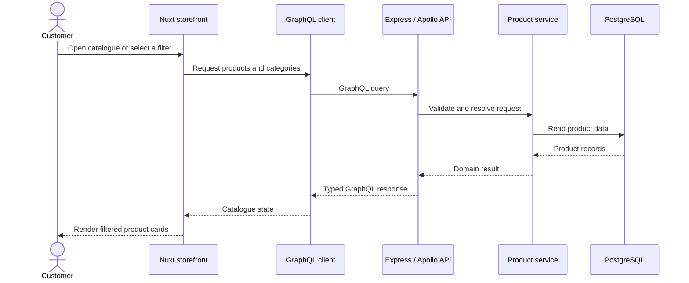

# Eagle Shopping EC

<p align="center">
  <strong>An editorial e-commerce experience for a focused streetwear collection.</strong>
</p>

<p align="center">
  <a href="#overview">Overview</a> ·
  <a href="#architecture">Architecture</a> ·
  <a href="#getting-started">Getting Started</a> ·
  <a href="#roadmap">Roadmap</a>
</p>

<p align="center">
  
  
  
  
  
  
</p>

## Overview

Eagle Shopping EC is a full-stack fashion commerce project built around a simple idea: a product catalogue should feel like an editorial experience, not a spreadsheet of items. The storefront combines campaign imagery, product storytelling, short collections, persistent filters, favourites, bag previews, and a responsive checkout-ready flow.

The project is designed as a portfolio-quality foundation for a real brand. It includes a customer storefront, authentication boundaries, a moderator area, a GraphQL API, PostgreSQL persistence, and a clear path for future services such as payment processing, image storage, and live inventory.

### Highlights

- Editorial, responsive storefront with campaign sections and motion-aware interactions.
- Product cards with media navigation, quick add-to-bag actions, favourites, price, and product context.
- Persistent filters for audience, product category, colour swatches, price presets, and a custom price ceiling.
- Bag and favourites previews in the header, including image, quantity, price, and running total.
- Thirty local catalogue records for a realistic pagination and browsing experience.
- GraphQL API backed by Express, Prisma, and PostgreSQL.
- Cookie-based authentication, role-aware moderator access, validation, rate limiting, and audit logging.
- Container-ready local development with Docker or Podman.

## Product story

The customer journey is deliberately paced:

1. A campaign introduces a model and the collection mood.
2. The most-viewed pieces make the first product interaction feel curated.
3. The full catalogue supports focused discovery through clear filters and pagination.
4. Editorial afterwords reinforce the brand message: *Made for repeat wear*, *Limited first edition*, and *Your uniform starts here*.
5. The bag and favourites remain close at hand without taking the customer away from the collection.

## Architecture

The repository is a small monorepo managed with npm workspaces. The web application and API are independently runnable, while sharing a single deployment and development workflow.



### Component UML



### Request sequence UML



### Repository structure

```text
shopping-eagle/
├── apps/
│   ├── api/                  # Express, Apollo, Prisma, authentication and tests
│   │   ├── prisma/           # Schema, migrations and seed data
│   │   └── src/              # GraphQL, services, security and configuration
│   └── web/                  # Nuxt customer and moderator interfaces
│       ├── app/components/   # Storefront, catalogue, header, bag and editorial UI
│       ├── app/pages/        # Customer, account and moderator routes
│       ├── app/features/     # Catalogue and commerce state
│       └── public/images/    # Optimised campaign imagery
├── docs/                     # Architecture and container notes
├── docker-compose.yml        # PostgreSQL for local development
├── podman-compose.yml        # Podman alternative
└── Containerfile             # Production-oriented application image
```

## Technology choices

| Area | Tooling | Why it is used |
| --- | --- | --- |
| Storefront | Nuxt 4, Vue 3, TypeScript | Component-driven UI, file-based routes, fast development, and typed client code. |
| Styling | CSS, Tailwind CSS | A custom editorial visual system with practical utility support when needed. |
| API | Express, Apollo Server, GraphQL | A typed contract for catalogue, authentication, and future commerce operations. |
| Data | PostgreSQL, Prisma | Relational data, schema migrations, type-safe queries, and seed support. |
| Validation | Zod | Runtime validation at API boundaries. |
| Security | Helmet, CORS, rate limiting, JWT cookies | Safer HTTP defaults, controlled origins, login protection, and server-managed sessions. |
| Testing | Vitest | Fast API validation and security-oriented test coverage. |
| Containers | Docker, Podman | Repeatable local database and application environments. |
| Quality | ESLint, TypeScript | Consistent code style and early error detection. |

## Getting started

### Prerequisites

- Node.js 20 or newer
- npm 10 or newer
- Docker Desktop or Podman Desktop
- PostgreSQL 16 when not using the supplied compose configuration

### 1. Configure environment values

Copy the example file and replace the development placeholders before using the application outside your own machine.

```bash
cp .env.example .env
```

The repository ignores `.env` files. Never commit real database passwords, session secrets, or deployment credentials.

### 2. Start PostgreSQL

```bash
docker compose up -d postgres
```

Or with Podman:

```bash
podman compose up -d postgres
```

### 3. Install packages and prepare the database

```bash
npm install
npm run db:generate
npm run db:migrate
npm run db:seed
```

### 4. Start the application

Run these commands in separate terminals:

```bash
npm run dev:api
```

```bash
npm run dev
```

The storefront runs at `http://localhost:3000` and the API runs at `http://localhost:4000`. During development, Nuxt proxies `/api/*` to the API service.

## Environment reference

| Variable | Purpose |
| --- | --- |
| `DATABASE_URL` | Prisma connection string for PostgreSQL. |
| `POSTGRES_USER` | Local database user for compose services. |
| `POSTGRES_PASSWORD` | Local database password for compose services. |
| `POSTGRES_DB` | Local database name. |
| `API_PORT` | Express API port; defaults to `4000` in the example. |
| `WEB_ORIGIN` | Allowed web origin used by CORS. |
| `SESSION_SECRET` | Secret used to sign authenticated sessions. Use a long random value in production. |
| `SEED_MODERATOR_EMAIL` | Initial moderator email for local seed data. |
| `SEED_MODERATOR_PASSWORD` | Initial moderator password for local seed data. Change it immediately outside development. |
| `NUXT_PUBLIC_GRAPHQL_URL` | Public GraphQL endpoint consumed by the storefront. |

## Useful commands

| Command | Description |
| --- | --- |
| `npm run dev` | Starts the Nuxt storefront. |
| `npm run dev:api` | Starts the Express and Apollo API in watch mode. |
| `npm run build` | Builds every workspace for production. |
| `npm run lint` | Runs ESLint across web and API workspaces. |
| `npm run test` | Runs API tests with Vitest. |
| `npm run db:generate` | Generates Prisma client types. |
| `npm run db:migrate` | Applies development migrations. |
| `npm run db:seed` | Loads local catalogue and moderator seed data. |
| `npm run podman:build` | Builds the container image with Podman. |
| `npm run podman:run` | Starts the built web image locally. |

## Current scope

The current application is a working commerce foundation. Catalogue browsing, product media, favourites, bag state, account routes, moderator routes, API boundaries, database modelling, and security controls are present.

The visual catalogue currently uses local editorial data so that the customer flow can be reviewed without depending on a remote service. The API and Prisma schema provide the path to replace that local data with persisted records.

## Roadmap

- [ ] Connect the storefront catalogue to live API records.
- [ ] Persist customer bags and favourites for authenticated users.
- [ ] Add inventory-aware variants and reservation rules.
- [ ] Integrate a payment provider and checkout workflow.
- [ ] Add cloud media storage and responsive image transformation.
- [ ] Evaluate Supabase for managed data, storage, or authentication needs where it best fits the production architecture.
- [ ] Add transactional emails, order tracking, and customer notifications.
- [ ] Expand automated tests across customer, moderator, and checkout paths.
- [ ] Add CI checks for linting, tests, builds, and dependency security.

## Security notes

- Authentication is designed around signed JWTs held in HttpOnly cookies.
- GraphQL query depth is limited and request payload size is restricted.
- Login routes are rate limited.
- Inputs are validated before reaching domain services.
- Product and moderator actions are structured around explicit role checks and audit services.
- Real environment files are ignored by Git. Use a secret manager for deployed environments.

## Portfolio notes

This repository intentionally documents both the customer experience and the engineering decisions behind it. It demonstrates product thinking, visual implementation, component architecture, API design, database modelling, basic application security, and a realistic growth plan.

## License

This project is shared for portfolio and evaluation purposes. Contact the repository owner before reusing its branding, imagery, or commercial concepts.
